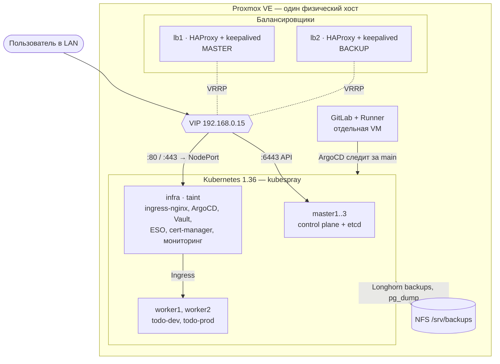
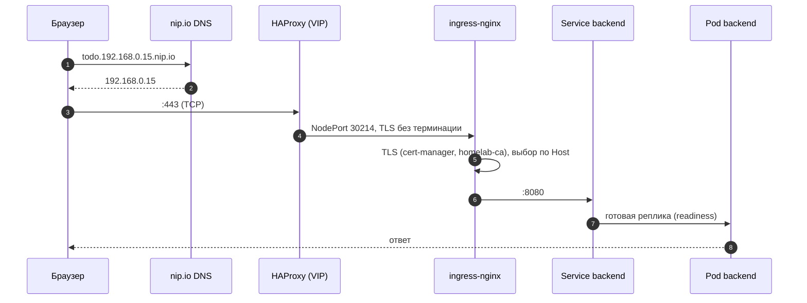
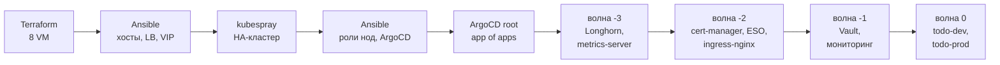
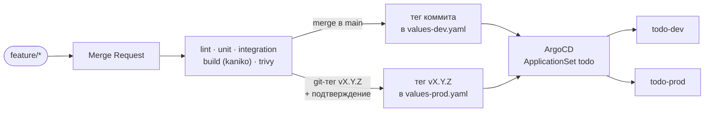
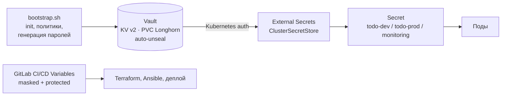

# kube-homelab-platform

Production-like Kubernetes-платформа на одном сервере Proxmox — от виртуальных машин
до приложения с окружениями dev и prod. Вся инфраструктура описана кодом и поднимается
пайплайнами GitLab CI; вручную остаётся только инициализация Vault.


## Что внутри

- **IaC от железа до приложения:** Terraform создаёт VM в Proxmox, Ansible готовит хосты и
  балансировщики, [kubespray](https://github.com/kubernetes-sigs/kubespray) разворачивает
  HA-кластер, ArgoCD поднимает платформу и приложение.
- **Отказоустойчивый control plane:** 3 мастера с etcd за парой HAProxy + keepalived (VIP).
- **GitOps:** ArgoCD app of apps с sync waves; деплой приложения — коммит тега образа в git.
- **Разделение нагрузки:** платформа изолирована на infra-ноде (метка + taint), приложение — на воркерах.
- **Секреты только в Vault:** External Secrets доставляет их в кластер, в репозитории секретов нет.
- **Наблюдаемость:** kube-prometheus-stack, RED-метрики приложения, алерты на ошибки, задержку и свежесть бэкапов.
- **Бэкапы вне кластера** с проверенной процедурой восстановления.
- **Безопасная доставка:** тесты (unit + integration), сканирование образа trivy, один образ dev → prod.

## Архитектура



| VM | vCPU | RAM | Роль |
|---|:-:|:-:|---|
| master1..3 | 2 | 5 ГБ | control plane, etcd |
| worker1, worker2 | 2 | 4 ГБ | приложение: backend, Postgres, Redis |
| infra | 4 | 8 ГБ | платформа: ingress, ArgoCD, Vault, ESO, cert-manager, мониторинг |
| lb1, lb2 | 2 | 1 ГБ | HAProxy + keepalived, VIP для API и сервисов |

Платформенные компоненты выбирают infra через `nodeSelector` и `tolerations`; у приложения
toleration нет, поэтому на infra оно не попадёт. Реплики backend разнесены по воркерам
`topologySpreadConstraints`, PodDisruptionBudget не даёт drain'у выселить их одновременно.

## Путь запроса



HAProxy работает в режиме TCP и не трогает TLS — его завершает ingress-nginx сертификатом
от собственного CA кластера. Новый сервис публикуется одним Ingress, без изменений на балансировщиках.

## Как поднимается стенд



Каждый шаг — джоба GitLab CI (`terraform_apply`, `ansible_provision`, `kubespray`, `platform`).
Всё, что меняет инфраструктуру, запускается только из `main` и вручную; `terraform_apply`
применяет ровно тот план, что был показан на стадии `terraform_plan`.
Порядок волн гарантирует, что CRD, хранилище и секреты готовы раньше, чем их потребители.

## Доставка приложения



- Образ собирается один раз и продвигается dev → prod: в prod попадает ровно то, что работало на dev.
- trivy блокирует деплой при HIGH/CRITICAL уязвимостях, для которых есть исправление.
- Окружения — не ветки, а `values-<env>.yaml` одного Helm-чарта. Откат — `git revert`.

| Окружение | Адрес | Обновление |
|---|---|---|
| dev | http://todo-dev.192.168.0.15.nip.io | автоматически после merge в `main` |
| prod | http://todo.192.168.0.15.nip.io | git-тег `vX.Y.Z` + ручное подтверждение |

Остальные сервисы (Grafana, Prometheus, Alertmanager, Vault, ArgoCD) доступны так же —
`<сервис>.192.168.0.15.nip.io`, по http и https.

## Секреты



Пароли приложения генерируются в Vault и не покидают кластер: ESO собирает из них DSN и
Secret'ы окружений. Секреты инфраструктуры (токен Proxmox, SSH-ключи, пароль VRRP) хранятся
в переменных GitLab CI. Репозиторий проверяется gitleaks.

## Наблюдаемость и надёжность

| | |
|---|---|
| Метрики | kube-prometheus-stack; приложение отдаёт RED-метрики на отдельном порту, наружу он не публикуется |
| Алерты | `BackendDown`, `BackendHighErrorRate`, `BackendHighLatency`, `PostgresBackupStale`, `LonghornVolumeBackupStale`, `LonghornVolumeDegraded/Faulted` + стандартные правила стека |
| Бэкапы | все тома Longhorn ежедневно (3 копии) и `pg_dump` prod (14 дней) на NFS вне кластера |
| Восстановление | дамп разворачивается в отдельную БД и сверяется — [IaC/README.md → Бэкапы](IaC/README.md#бэкапы) |
| Отказоустойчивость | 3 control plane + etcd, VIP на паре LB, HPA и PDB для prod, graceful shutdown, Vault распечатывается сам после рестарта |
| Хранилище | Longhorn, 2 реплики тома на разных нодах |

## Структура репозитория

```
.gitlab-ci.yml        корневой пайплайн: запускает дочерние по изменённым путям
app/                  Go-сервис, Dockerfile, CI приложения
charts/todo/          Helm-чарт приложения: values.yaml + values-dev/prod.yaml
IaC/terraform/        VM в Proxmox (модуль vm)
IaC/ansible/          хосты, балансировщики, NFS, роли нод, ArgoCD
IaC/inventory/        inventory и настройки kubespray
IaC/kubespray/        kubespray — git submodule, сторонний проект
IaC/argocd/           root (app of apps), apps/ — компоненты платформы, manifests/ — свои манифесты
IaC/vault/            инициализация и политики Vault
IaC/ci/               шаблоны CI для Terraform и Ansible
```

Документация по слоям: [IaC/README.md](IaC/README.md) — инфраструктура, ArgoCD, размещение,
ingress, Vault, бэкапы; [app/README.md](app/README.md) — приложение, API, CI/CD и релизы.

## Быстрый старт

```bash
git clone --recurse-submodules https://github.com/loowpts/kube-homelab-platform.git
```

1. Заполнить CI/CD Variables — список в [IaC/README.md](IaC/README.md#cicd-variables-проекта-homelab).
2. `terraform` → `terraform_apply` — виртуальные машины.
3. `ansible` → `ansible_provision` — пакеты, балансировщики, VIP.
4. `kubespray` — кластер.
5. `platform` — роли нод и ArgoCD, затем `kubectl apply -f IaC/argocd/root.yaml`.
6. `IaC/vault/bootstrap.sh` — инициализация Vault и секреты.

Только приложение, локально: `cd app && docker compose up --build` → http://localhost:8080.

## Осознанные компромиссы

| Решение | Почему так |
|---|---|
| Всё на одном физическом хосте | домашний стенд; бэкапы переживают потерю кластера, но не хоста — следующий шаг S3 на другом железе |
| Unseal-ключ Vault в Secret кластера | auto-unseal без внешнего KMS; root token в кластере не хранится |
| Собственный CA, http без редиректа на https | только локальная сеть; https доверенный после импорта корня CA |
| Имена через публичный nip.io | без собственного DNS; при необходимости — `/etc/hosts` |
| Один Postgres на окружение | бэкапы и проверенное восстановление вместо HA-кластера БД |
| ingress-nginx | проект выведен из поддержки — запланирован переход на Gateway API |

## Сторонние компоненты

Кластер разворачивается с помощью **[kubespray](https://github.com/kubernetes-sigs/kubespray)** —
проекта Kubernetes SIGs, распространяемого по лицензии
[Apache License 2.0](https://github.com/kubernetes-sigs/kubespray/blob/master/LICENSE).
Он подключён как git submodule (`IaC/kubespray`, тег `v2.32.0`) и в этом репозитории не изменяется.
Мои файлы — inventory и `group_vars` в [`IaC/inventory/mycluster`](IaC/inventory/mycluster),
созданные на основе его [`inventory/sample`](https://github.com/kubernetes-sigs/kubespray/tree/v2.32.0/inventory/sample).

Платформенные компоненты (ArgoCD, Longhorn, cert-manager, External Secrets, ingress-nginx,
Vault, kube-prometheus-stack, metrics-server) устанавливаются из официальных Helm-чартов
и манифестов их авторов; версии закреплены в [`IaC/argocd/apps`](IaC/argocd/apps).
